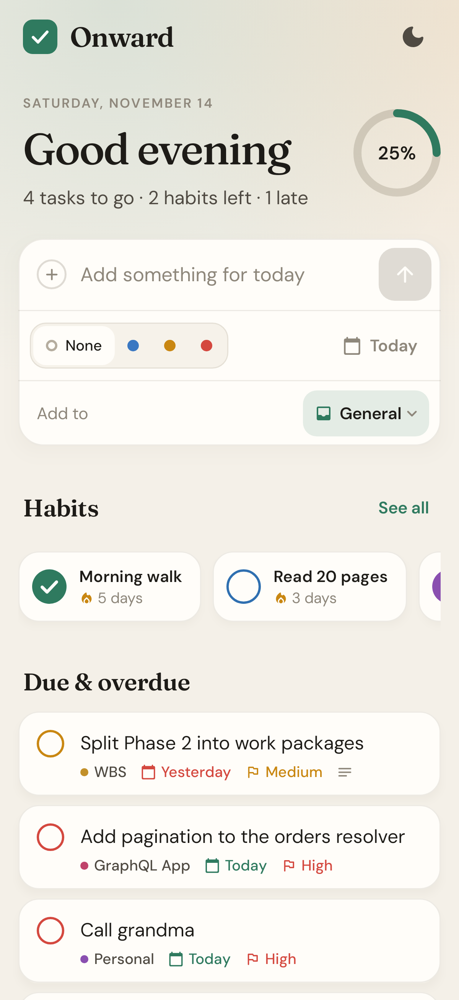
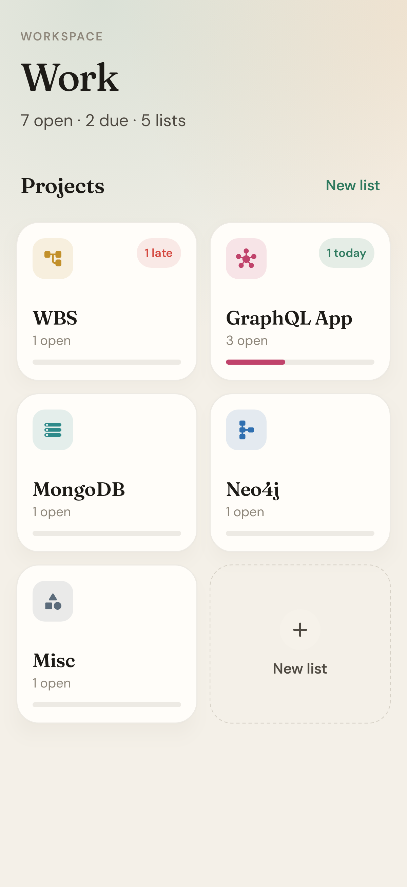
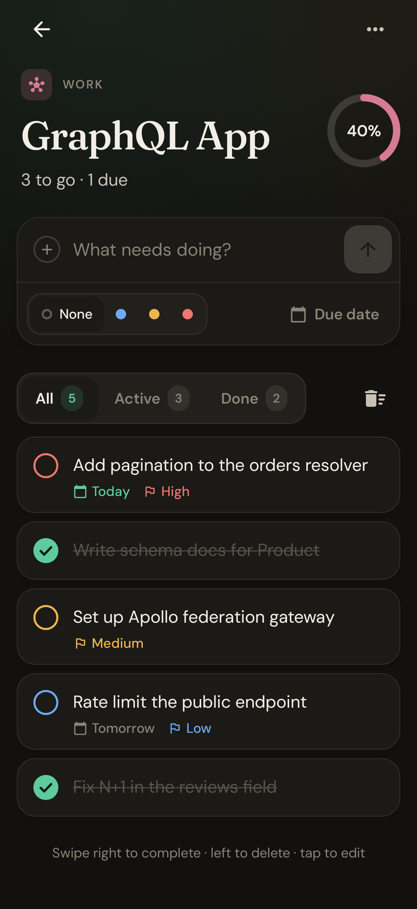
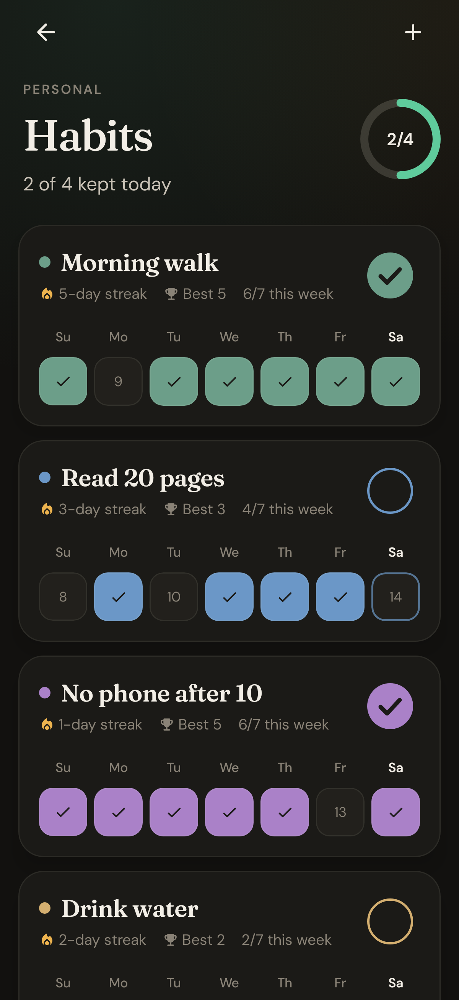

# Onward

A calm, beautiful place for your work, your to-dos and your habits. Native Android, written in Kotlin with Jetpack Compose.

<p align="center">
  
  
  
  
</p>

## How it's organised

Three tabs along the bottom:

| Tab | What's there |
| --- | --- |
| **Today** | Everything due today or overdue, from every list, plus today's habits to tick off. Quick capture can drop a task into any list. |
| **Personal** | The **habit tracker**, plus **General** and **Personal** to-do lists. |
| **Work** | A list per project: **WBS**, **GraphQL App**, **MongoDB**, **Neo4j** and **Misc**. |

Add, rename, recolour or remove lists in either space: tap **New list**, or long-press a list card. Each list gets one of eight colours and an icon.

## Features

**Tasks**
- Quick capture with a priority (None, Low, Medium, High) and a due date: Today, Tomorrow, Next week, or any date you pick.
- Tap a task to edit its title, notes, priority, due date, or move it to another list.
- Swipe right to complete, swipe left to delete (with undo).
- All, Active and Done filters with live counts, "Clear completed" with undo, and confetti when a list is finished.
- Due dates read as *Today*, *Tomorrow* or *Thursday*, and overdue tasks are highlighted. Project cards flag what's late or due today.

**Habits**
- Tick off today with one tap, or fill in any of the last seven days.
- Current streak, best streak and this week's count for each habit, and a week-at-a-glance chart on the Personal tab.

**Everywhere**
- Warm light and dark themes. The app follows your system; the sun/moon button on Today switches.
- Everything is stored on your device.

## Install on Android with Obtainium

Every push to `main` builds a signed APK and publishes it on the [Releases page](https://github.com/aadil-zeyn/Onward/releases). This needs a one-time [signing setup](#release-signing).

1. Install [Obtainium](https://github.com/ImranR98/Obtainium).
2. Tap **Add App** and paste `https://github.com/aadil-zeyn/Onward`.
3. Tap **Add**, then **Install**. Obtainium will notify you when a new build is released.

Each release is a single APK of about 2 MB that works on any phone running Android 8 or later.

### Upgrading from the Flutter version

Onward 2 keeps the same app ID and signing key, so it installs over the Flutter version as a normal update. On first launch it brings across your tasks (into **General**), your habits and your theme choice.

## Develop

You need JDK 17 or later and the Android SDK (platform 37). Open the project in Android Studio, or:

```sh
./gradlew testDebugUnitTest                                 # unit and screenshot tests
./gradlew testDebugUnitTest -Proborazzi.test.record=true    # also re-draw docs/screens/*.png
./gradlew installDebug                                      # run on a connected phone
./gradlew assembleRelease                                   # app/build/outputs/apk/release/
```

The screenshot tests render every screen in both themes with [Robolectric](https://robolectric.org) and [Roborazzi](https://github.com/takahirom/roborazzi), so no emulator is needed.

```
app/src/main/java/com/aadil/onward/
  model/      Tasks, lists, habits; dates, streaks and due-date labels
  data/       JSON storage (and the Flutter import), view model
  ui/theme/   Colours and type: Fraunces and DM Sans on warm paper
  ui/components/  Composer, task row, check circle, progress ring, confetti…
  ui/screens/ Today, Personal/Work spaces, a list, habits, and the edit sheets
```

## Release signing

Android only installs an update when it's signed with the same key as the installed app, so releases are signed with a private key kept in GitHub secrets. Pull-request builds use a throwaway debug key and are never published.

One-time setup (on a computer with Java installed):

```sh
keytool -genkeypair -v -keystore onward-release.jks -storetype PKCS12 \
  -alias onward -keyalg RSA -keysize 2048 -validity 10000
base64 -w0 onward-release.jks   # on macOS: base64 -i onward-release.jks
```

Then add these repository secrets (Settings → Secrets and variables → Actions):

| Secret | Value |
| --- | --- |
| `ANDROID_KEYSTORE_BASE64` | the base64 output above |
| `ANDROID_KEYSTORE_PASSWORD` | the keystore password you chose |
| `ANDROID_KEY_ALIAS` | `onward` |
| `ANDROID_KEY_PASSWORD` | only if it differs from the keystore password |

Keep `onward-release.jks` and its password somewhere safe and never commit them. If the key is lost, future builds can't update an installed copy, and you'd have to uninstall and reinstall.

If you already set these up for the Flutter version, there's nothing to do: the same secrets sign the Kotlin build.

## Fonts

[DM Sans](https://fonts.google.com/specimen/DM+Sans) and [Fraunces](https://fonts.google.com/specimen/Fraunces) are bundled under the SIL Open Font License (`app/src/main/assets/licenses/`).
