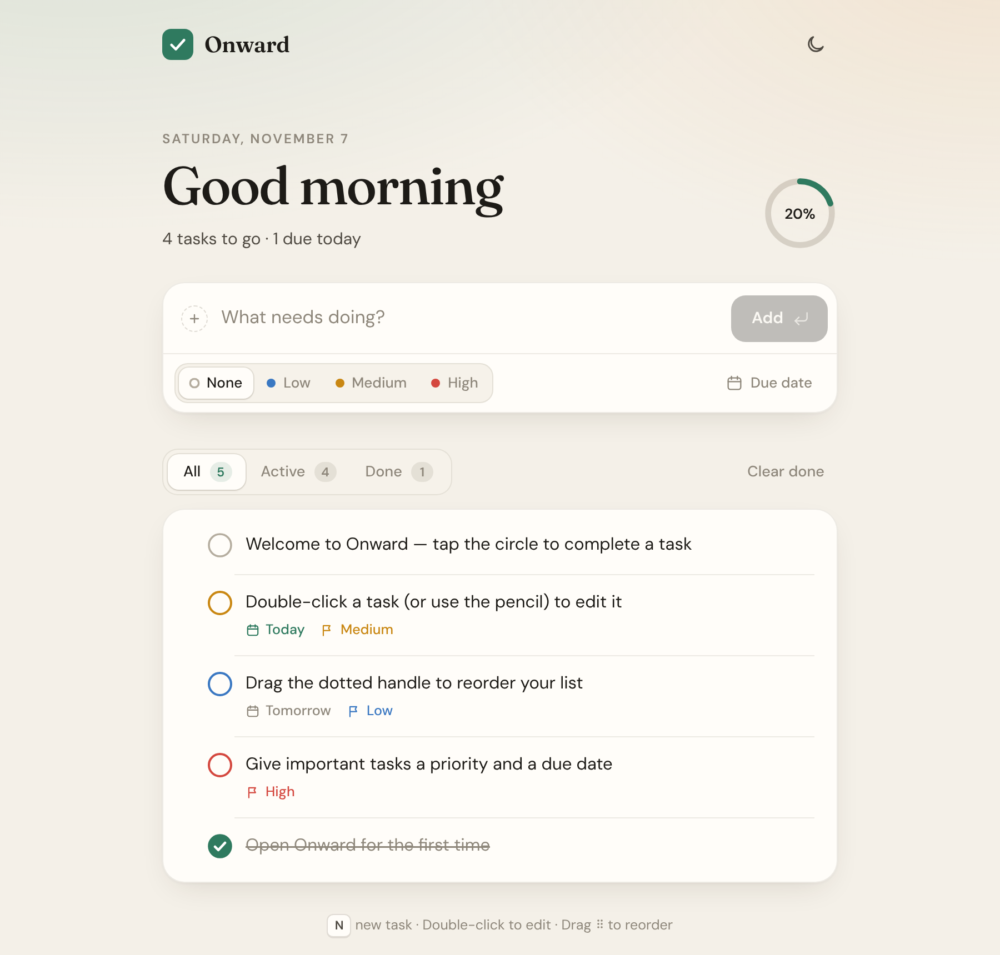
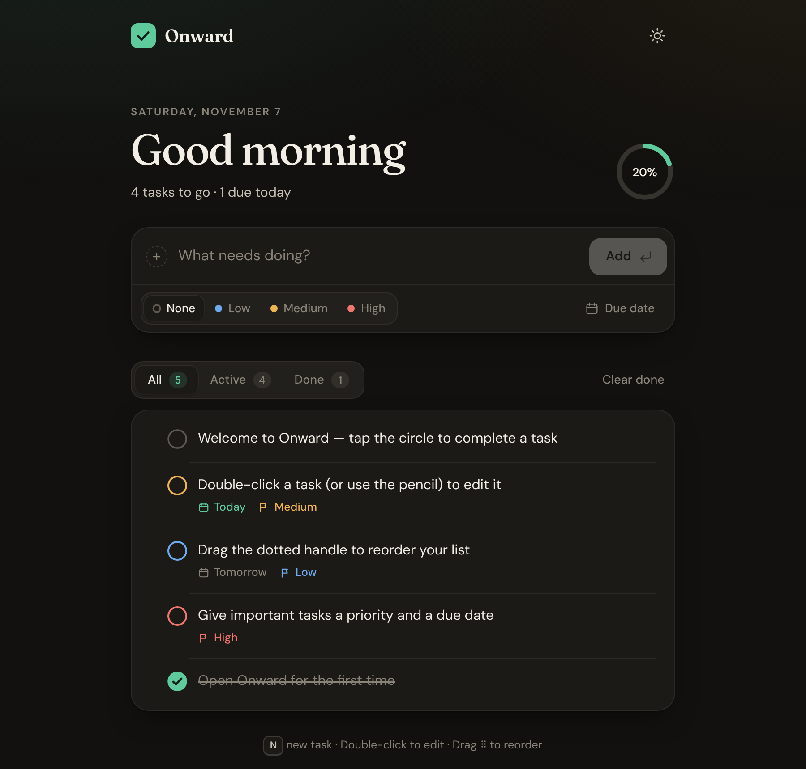

# Onward

A calm, beautiful todo list. It is plain HTML, CSS and JavaScript, with no dependencies and no build step.

<p align="center">
  
  
</p>

## Features

- **Quick capture:** type and press <kbd>Enter</kbd>. You can set a priority (none, low, medium or high) and a due date (Today, Tomorrow, Next week, or any date you pick).
- **Satisfying completion:** the checkbox animates, a line strikes through the title, a progress ring tracks the day, and a small confetti burst plays when you clear everything.
- **Inline editing:** double-click a task or press the pencil to change its title, priority or due date. Saving an empty title deletes the task.
- **Drag to reorder:** grab the dotted handle. This works with a mouse, touch or pen. With the handle focused, <kbd>↑</kbd> and <kbd>↓</kbd> move the task.
- **Filters:** All, Active and Done, each with a live count.
- **Undo:** deleting a task or clearing done tasks shows an undo toast. <kbd>Ctrl/⌘</kbd>+<kbd>Z</kbd> also works.
- **Smart due dates:** labels like *Today*, *Tomorrow* or *Thursday*, with overdue tasks highlighted and counted in the header.
- **Light and dark themes:** follows your system theme, and the toggle in the top bar overrides it.
- **Saved locally:** tasks are stored in `localStorage` and stay in sync across open tabs.
- **Accessible and responsive:** keyboard shortcuts, ARIA roles, reduced-motion support and a layout built for phones.

## Keyboard shortcuts

| Key | Action |
| --- | --- |
| <kbd>N</kbd> or <kbd>/</kbd> | Focus the new-task field |
| <kbd>Enter</kbd> | Add the task, or save an edit |
| <kbd>Esc</kbd> | Cancel the edit, or close the menu |
| <kbd>↑</kbd> <kbd>↓</kbd> on a handle | Move a task |
| <kbd>←</kbd> <kbd>→</kbd> on the filters | Switch filter |
| <kbd>Ctrl/⌘</kbd>+<kbd>Z</kbd> | Undo a delete |

## Run it

Open `index.html` in a browser, or serve the folder:

```sh
python3 -m http.server 8000
# then visit http://localhost:8000
```

Because it's a static site, it deploys as-is to GitHub Pages, Netlify, Vercel or any other static host.

## Project layout

```
index.html   markup, icons and the task template
styles.css   design tokens (light/dark), layout and animations
app.js       state, rendering, drag & drop, persistence
favicon.svg  app icon
```
