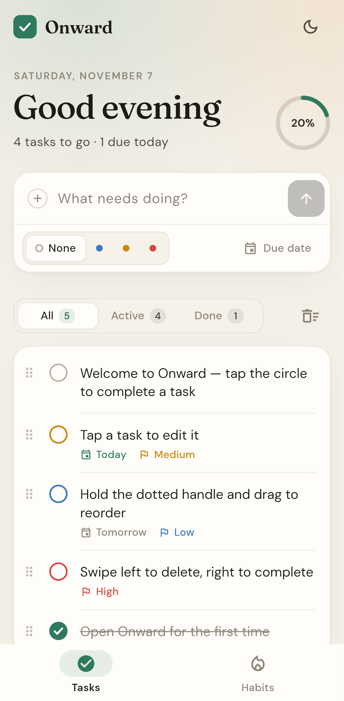
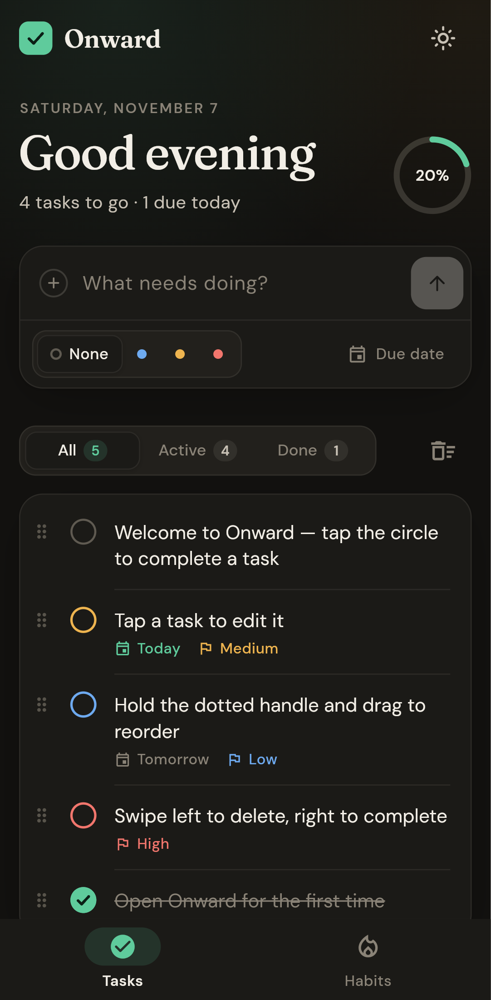
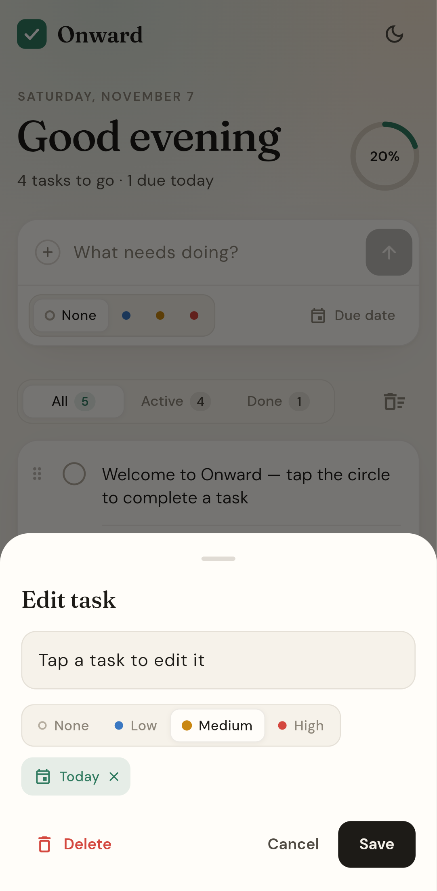

# Onward

A calm, beautiful place for your tasks and habits, built with Flutter.

<p align="center">
  
  
  
</p>

## Install on Android with Obtainium

Every push to `main` builds a signed APK and publishes it on the [Releases page](https://github.com/aadil-zeyn/Onward/releases). This needs a one-time [signing setup](#release-signing).

1. Install [Obtainium](https://github.com/ImranR98/Obtainium).
2. Tap **Add App** and paste `https://github.com/aadil-zeyn/Onward`.
3. Tap **Add**, then **Install**. Obtainium will notify you when a new build is released.

Each release has one APK per CPU type, and Obtainium picks the right one automatically. To download one yourself from the latest release, take `arm64-v8a`, which suits almost every phone from the last several years.

## Features

**Tasks**
- Quick capture with a priority (None, Low, Medium, High) and a due date: Today, Tomorrow, Next week, or any date you pick.
- A checkbox that animates, a progress ring for the day, and a burst of confetti when everything's done.
- Tap a task to edit it. Swipe right to complete it, or swipe left to delete it (with undo).
- Hold the dotted handle and drag to reorder.
- All, Active and Done filters with live counts, plus "Clear done" with undo.
- Due dates read as *Today*, *Tomorrow* or *Thursday*, and overdue tasks are highlighted.

**Habits**
- Track daily habits with a seven-day history and streaks.

**Everywhere**
- Warm light and dark themes. The app follows your system by default, and the sun/moon button switches.
- Everything is stored on your device.

## Develop

```sh
flutter pub get
flutter run           # on a device or emulator
flutter test
flutter build apk     # build/app/outputs/flutter-apk/app-release.apk
```

## Release signing

Android only installs an update when it's signed with the same key as the installed app, so releases are signed with a private key kept in GitHub secrets. Pull-request builds use a throwaway debug key and are never published.

One-time setup (on a computer with Java installed):

```sh
keytool -genkeypair -v -keystore onward-release.jks -storetype PKCS12 \
  -alias onward -keyalg RSA -keysize 2048 -validity 10000
base64 -w0 onward-release.jks   # on macOS: base64 -i onward-release.jks
```

Then add these repository secrets (Settings → Secrets and variables → Actions):

| Secret | Value |
| --- | --- |
| `ANDROID_KEYSTORE_BASE64` | the base64 output above |
| `ANDROID_KEYSTORE_PASSWORD` | the keystore password you chose |
| `ANDROID_KEY_ALIAS` | `onward` |
| `ANDROID_KEY_PASSWORD` | only if it differs from the keystore password |

Keep `onward-release.jks` and its password somewhere safe and never commit them. If the key is lost, future builds can't update an installed copy, and you'd have to uninstall and reinstall.

Until the secrets exist, pushes to `main` still run the analyzer and tests, but the release step stops with a message explaining what's missing.

## Fonts

[DM Sans](https://fonts.google.com/specimen/DM+Sans) and [Fraunces](https://fonts.google.com/specimen/Fraunces) are bundled under the SIL Open Font License (`assets/fonts/`).
